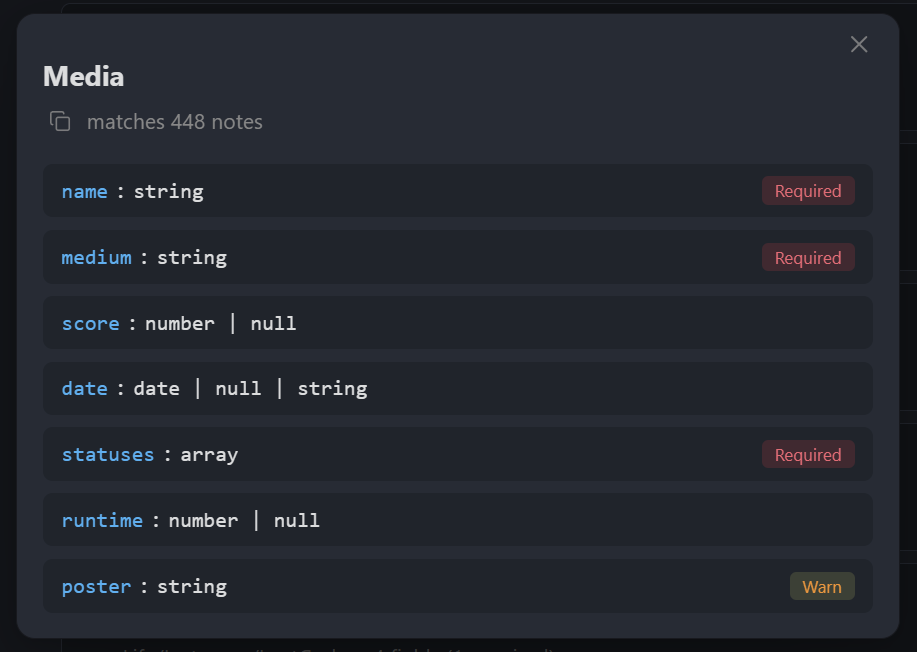
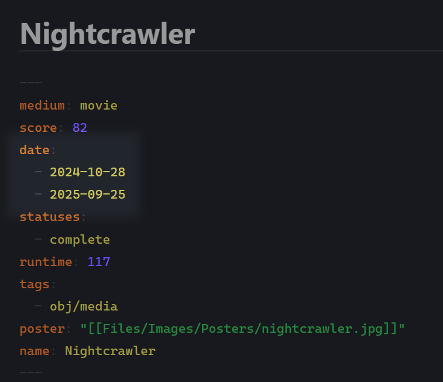
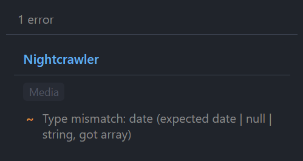

# Propsec

Schema enforcement for Obsidian properties. 

Define schemas based on templates or invariants in your vault, add custom reusable types, and more.

# Usage
First, define a schema:

  

Once saved, violating notes such as this one...

  

...will be caught by the validation:

  

## Why

Obsidian properties are freeform. Over time, things can break: you change the structure, use an old field, etc. This plugin validates notes against schemas you define. Your notes are untouched, but your vault's consistency becomes easier to manage.

## Setup

1. Open plugin settings
2. Create a schema: click **+ Add Schema**
3. Write a rule for which notes it applies to, e.g. `file.inFolder("Books")`
4. Add fields: name, type, required/optional, and optional rules
5. Violations appear in the status bar/sidebar

## Rules

Everything that picks or checks something is a rule, written in a small expression language. Press Ctrl+Space in a rule box for helpers like "at most N characters" or "in folder". This will insert the rule for you.

| Where | Example | Meaning |
|-------|---------|---------|
| Schema: applies to | `file.inFolder("Books") \|\| file.hasTag("book")` | Notes in Books, or tagged #book |
| Field: value must | `size(it) >= 1 && size(it) <= 5` | Between 1 and 5 items |
| Field: value must | `it.exists(t, t.matches("^genre/"))` | Has a tag starting with `genre/` |
| Field: value must | `it >= started` | On or after the `started` property |
| Field: applies when | `status == "finished"` | Only check this field for finished notes |
| Settings: excluded notes | `file.hasTag("archived")` | No schema checks archived notes |

A rule reads properties by name (`rating`, or `note["date created"]` when the name has spaces), the field's own value as `it`, and the file through `file`: `file.path`, `file.name`, `file.folder`, `file.tags`, `file.mtime`, `file.ctime`, `file.inFolder(...)`, `file.hasTag(...)`.

The syntax follows [CEL](https://cel.dev), [adjusted for frontmatter](https://github.com/ccmdi/propsec-rules#rules).

## Field types
### Primitives
`string`, `number`, `boolean`, `date`, `array`, `object`, `null`, `unknown`

### Custom types
Define reusable types in settings. A custom type is a named group of fields. Use them when multiple schemas share the same structure or you need nested validation.

### Union types
Add multiple field entries with the same name but different types. For example, two entries for `status` with types `string` and `null` creates `string | null`.

## Field flags
Fields can be flagged to be **required** (key is required) xor **warn** (soft requirement). There is also a **unique** flag that prevents duplicate values on that field across notes.
